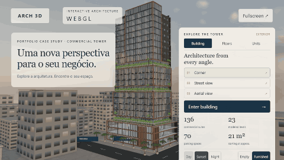
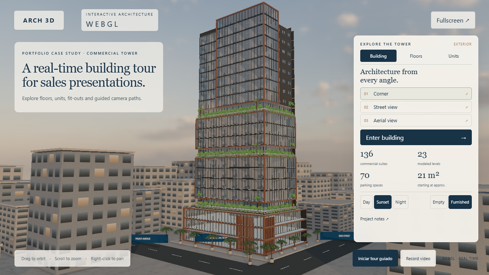
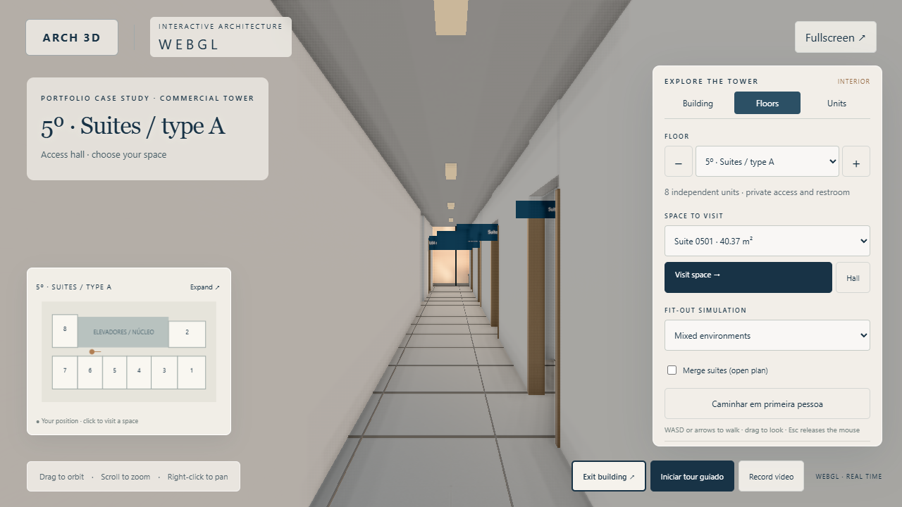
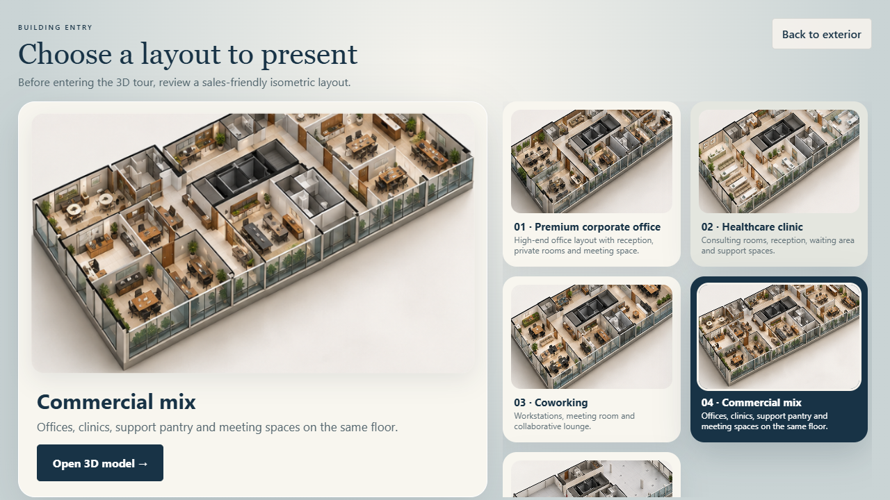

# Architectural 3D Tour Portfolio

Interactive WebGL architectural tour built with Three.js and Vite. This is a sanitized portfolio version: client identity, original plans, addresses, internal notes, Android kiosk files and private deployment scripts were removed.

## Live demo

Open the interactive project here:

[https://kzzin.github.io/architectural-3d-tour-portfolio/](https://kzzin.github.io/architectural-3d-tour-portfolio/)

## Media preview

### Building rotation GIF



### Short video

[Watch the MP4 demo](docs/demo-building-tour.mp4)

### Screenshots

| Exterior 3D view | Floor selection | Isometric layout |
|---|---|---|
|  |  |  |

## Highlights

- Real-time 3D commercial tower navigation.
- Floor and unit selection with procedural floor plans.
- Fit-out simulations for office, clinic, meeting, retail and lounge use cases.
- Guided camera tour, first-person walking mode and responsive controls.
- Static build with local assets.

## Stack

- JavaScript ES modules
- Three.js
- Vite
- WebGL materials, procedural geometry and optimized static assets

## Run locally

```bash
npm ci
npm run dev
```

Open the local URL printed by Vite.

## Production build

```bash
npm run build
npm run preview
```

## Asset credits

See `public/assets/cars/SOURCES.md` and `public/assets/pbr/SOURCES.md` for third-party asset notes.

## Portfolio note

The geometry and measurements are approximate and intended to demonstrate an interactive presentation workflow, not an engineering deliverable.
